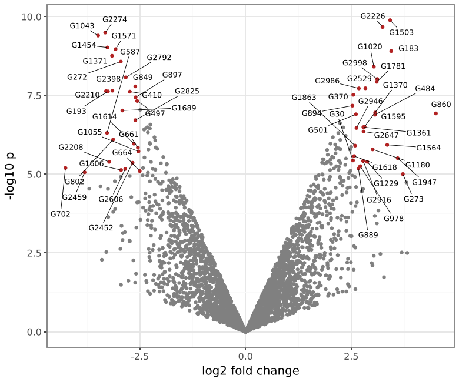

# plotnine-extensions

Extensions for [plotnine](https://github.com/has2k1/plotnine) in the spirit
of the ggplot2 ecosystem. Everything here is a plain plotnine geom or
helper: install the package, import it, and add the layers to a plot.

**Documentation: https://vmindel.github.io/plotnine_extensions/**

```bash
pip install git+https://github.com/vmindel/plotnine_extensions
```

| Feature | ggplot2 counterpart | What it does |
|---|---|---|
| `rasterise()` | ggrastr | Renders one layer as a bitmap at its own dpi inside PDF/SVG/PS output |
| `geom_text_repel`, `geom_label_repel` | ggrepel | Labels that move off each other and off the points, with leader segments |
| `stat_compare_means`, `geom_bracket` | ggpubr, ggsignif | Tests between groups as brackets with stars or p-values |
| `stat_halfeye`, `geom_raincloud` | ggdist | Densities with medians and intervals; raincloud plots |
| `geom_logo`, `logo_data` | ggseqlogo | Sequence logos, including signed contribution scores |
| `geom_curve`, `geom_hex` | ggplot2 | Curved arrows; hexagonal binning |
| `theme_pubr`, `theme_cowplot`, `theme_minimal_hgrid`, ... | ggpubr, cowplot | Publication themes, plus `rremove`, `rotate_x_text`, `background_grid` and other helpers |

## `rasterise`: per-layer rasterisation

Large scatter plots make vector figures huge and slow to open. Wrap the
heavy layer; axes, text, legends and the other layers stay vector.

```python
from plotnine import ggplot, aes, geom_point, geom_smooth
from plotnine_extensions import rasterise

p = (
    ggplot(df, aes("x", "y"))
    + rasterise(geom_point(alpha=0.2, size=0.5), dpi=300)
    + geom_smooth(method="lm")          # stays vector
)
p.save("fig.pdf")
```

`rasterise` accepts a geom, a stat, a layer, a list of these, or a whole
`ggplot` (optionally `layers=["point", "tile"]` to choose which). With
50,000 points the PDF goes from 8.3 MB (vector) to 0.3 MB at 300 dpi.

How it differs from plotnine's `raster=True`: that sets matplotlib's
`rasterized` flag, which renders at the dpi passed to `save` and only
works on geoms that forward the flag. `rasterise` works on any geom and
fixes the resolution per layer, independent of the save dpi. At equal dpi
the output is pixel-identical to matplotlib's own rasterisation. On PNG
output it changes nothing.

## `geom_text_repel` / `geom_label_repel`



```python
from plotnine_extensions import geom_text_repel, geom_label_repel

df = df.sort_values("nlp", ascending=False)  # earlier rows win if space runs out
df["lab"] = np.where(df["sig"], df["gene"], "")

(
    ggplot(df, aes("lfc", "nlp"))
    + geom_point(aes(color="sig"), size=1)
    + geom_text_repel(aes(label="lab"), size=8, point_size=1)
)
```

Placement runs inside matplotlib's draw, with the renderer that writes the
file. Label sizes and positions are measured on the final figure (after
plotnine's layout, at the output dpi), so saving at another size or
format gives a correct layout instead of one computed for a provisional
axes. plotnine's built-in `geom_text(adjust_text=...)` adjusts once when
the layer is drawn and documents that it misbehaves as the first or only
layer; this has no such restriction.

Behaviour worth knowing:

- Rows with an empty or missing label are not labelled, but their points
  still push labels away. Label a subset by blanking the others, not by
  subsetting the data.
- `point_size` should match the size of the points you draw, so labels
  avoid the markers and not only their centres.
- `nudge_x` / `nudge_y` move where a label starts; the segment still
  points at the data point.
- `max_overlaps` (default 10) drops labels that, after placement, still
  overlap more than that many labels or points. Earlier rows have
  priority. A warning says how many were dropped.
- `seed=1` by default, so a figure renders identically each time.
- `xlim` / `ylim` are in data units, through the scale's transformation
  (log, reverse).
- Units of `box_padding`, `point_padding`, `min_segment_length` and
  `segment_size` are points (1/72 inch), not ggrepel's "lines".

Full parameter list: `help(geom_text_repel)`.

The solver is an independent implementation (position-based dynamics with
springs to the anchors, then a pass that swaps labels whose segments
cross). No ggrepel code was used, so the package can stay MIT licensed.
ggrepel is GPL-3; porting its C++ would have required GPL here as well.

## Claude Code skill

The package ships a skill that teaches Claude Code these features and
their pitfalls. Install it once with `plotnine-extensions-install-skills`;
see the [docs](https://vmindel.github.io/plotnine_extensions/claude-skill/).

## Development

```bash
pip install -e '.[test,docs]'
pytest
python docs/gen_figures.py   # run the docs examples, refresh docs/img
mkdocs serve                 # preview the docs at http://127.0.0.1:8000
```

Pushes to the default branch build and publish the docs to GitHub Pages
(`.github/workflows/docs.yml`); other branches and pull requests only
build them, which also checks that every example still runs.

Tested against plotnine's development branch (post 0.15.8). It uses a few
plotnine internals (`plotnine._utils`, geom `draw_panel`/`draw_layer`), so
pin plotnine if you need stability.
