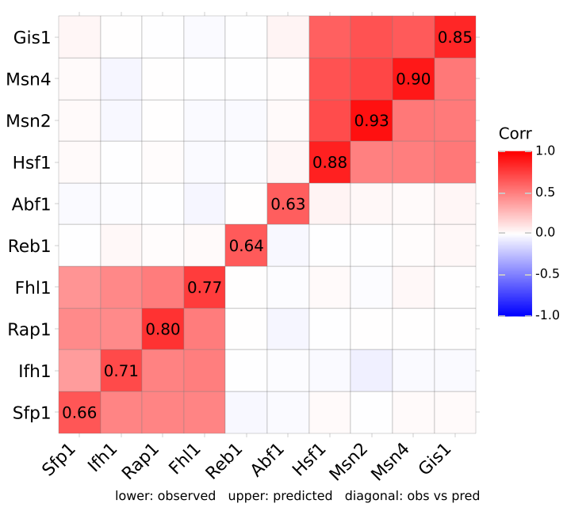

# Correlation matrices

`ggcorrplot` draws a correlation matrix as a heatmap, after R's
ggcorrplot. It takes the matrix, not the data: compute it first with
`df.corr()` (any method), and pass p-values from `cor_pmat` to mark or
hide the insignificant cells. The result is an ordinary `ggplot`, so
themes, scales and further layers add on with `+`.

## Triangle, clustering, labels

```python
--8<-- "examples/corr_basic.py"
```


`hc_order=True` orders the variables by hierarchical clustering on
(1 − r) / 2, so strongly anticorrelated variables count as far apart, not
as a module. `hc_method` picks the linkage (`"complete"` by default).

## Significance

```python
--8<-- "examples/corr_pmat.py"
```


`cor_pmat` tests every pair of columns with `scipy.stats` (Pearson,
Spearman or Kendall), using the rows where both are present. Cells with
p above `sig_level` (0.05) get a cross, or with `insig="blank"` are not
drawn. An n-variable matrix is n(n − 1) / 2 tests, so pass
`adjust="holm"` or `"bh"` unless you have a reason not to; R's
`cor_pmat` does not adjust.

## Two matrices in one figure

`upper=` puts a second matrix in the upper triangle and `diag=` one
value per variable on the diagonal; `corr` then fills only the lower
triangle. The typical case is a model's output against the data:
observed correlations below, predicted above, and each variable's
observed-vs-predicted correlation on the diagonal.

```python
--8<-- "examples/corr_obs_pred.py"
```



- The lower triangle is the one below the diagonal: bottom-right here,
  bottom-left with `layout="matrix"`. Say which is which in the figure
  (a caption, as here): the two halves look alike.
- The diagonal is a different quantity on the same colour scale, so its
  cells are labelled by default (`lab_diag=False` turns that off).
- `hc_order` clusters on `corr` only, so the observed data sets the
  order and the predicted half cannot pull it towards the model.
- `p_mat` applies to `corr`'s cells; `p_upper` and `p_diag` give the
  p-values of the other two parts. Parts without p-values are never
  marked.
- `upper` and `diag` are aligned to `corr` by label when they are a
  DataFrame or Series, by position when they are arrays.
- Mirrored cells sit across the diagonal from each other, which is good
  for seeing that the block structure is preserved and poor for reading
  how much each pair changed. For that, plot the pairs directly:
  `p.data.query("part != 'diag'")` holds every cell's value and part.

## Arguments

| | |
|---|---|
| `method="square"` | Tiles; `"circle"` draws circles with area proportional to \|r\| |
| `type="full"` | Also `"lower"`, `"upper"`: below or above the diagonal as drawn |
| `layout="plot"` | First variable bottom left, diagonal rising (ggcorrplot); `"matrix"` puts it top left with the diagonal falling, as a printed matrix or corrplot |
| `show_diag=None` | Diagonal drawn for `"full"` only, unless set |
| `hc_order=False`, `hc_method="complete"` | Cluster the variables |
| `lab=False`, `lab_size=11`, `lab_col`, `digits=2` | Coefficients in the cells |
| `p_mat=None`, `sig_level=0.05`, `insig="pch"` | Mark (`"pch"`) or drop (`"blank"`) insignificant cells |
| `pch="x"`, `pch_col`, `pch_cex=5` | The mark: a matplotlib marker and its `geom_point` size |
| `colors=("blue", "white", "red")` | Fill at −1, 0 and 1 |
| `outline_color="gray"` | Tile border or circle outline |
| `ggtheme=theme_minimal` | Base theme, a class or an instance |
| `tl_cex=12`, `tl_col`, `tl_srt=45` | Tick label size (points), colour, x rotation |
| `title`, `show_legend`, `legend_title="Corr"` | |
| `upper=None`, `diag=None`, `p_upper=None`, `p_diag=None`, `lab_diag=None` | A second matrix above the diagonal, a vector on it, and their p-values |

The plot's data has one row per drawn cell with columns `var1` (x),
`var2` (y), `value`, `abs_corr`, `part` (`"lower"`, `"upper"`, `"diag"`)
and, with p-values, `pvalue`, for layers of your own.

## Differences from R

- **Argument names swap dots for underscores**: `hc.order` is
  `hc_order`, `p.mat` is `p_mat`, `tl.cex` is `tl_cex`.
- **`lab_size` is in points.** R's `lab_size = 4` (mm) is about 11.
- **`pch` is a matplotlib marker**, not an R symbol number: R's default
  `pch = 4` is `"x"`.
- **Circle area is proportional to \|r\|, from 0 to 1.** ggcorrplot
  rescales circle size to the range of the matrix, so the weakest
  correlation in a matrix still draws a mid-sized circle and sizes do
  not compare across figures.
- **Insignificant cells with `insig="blank"` are not drawn at all**,
  labels included.
- **Clustering uses scipy.** The tree matches R's `hclust` for the same
  linkage, but leaves can come out in a different left-right order.
  `hc_method="ward.D2"` maps to scipy's `"ward"` and `"mcquitty"` to
  `"weighted"`; R's `"ward.D"` has no scipy counterpart.
- **Raw data is refused.** A matrix with values outside [−1, 1] raises
  an error instead of being plotted as if it were correlations.
- Labels keep trailing zeros (`0.50`, not `0.5`).
- `upper`, `diag`, `p_upper`, `p_diag`, `lab_diag` and `layout` have no
  ggcorrplot counterpart.
- Not included: `as.is`.
