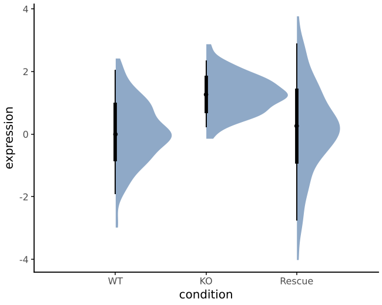
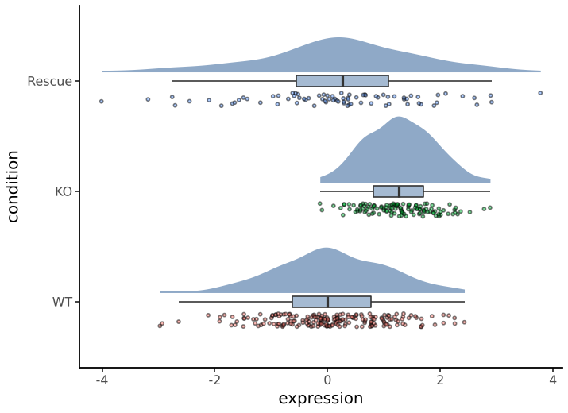

# Distributions

Show a distribution together with its summary, in the spirit of R's
ggdist. Categories go on x and values on y; add `coord_flip()` for
horizontal plots.

## Half-eye

`stat_halfeye()` draws a density slab with the median and its 66%
(thick) and 95% (thin) intervals at its base.

```python
--8<-- "examples/halfeye.py"
```



- **Slab size:** `width` sets the maximum slab thickness.
- **Scaling across groups:** `scale` works as in `geom_violin`. `"area"` (the default) puts all densities on one scale; `"count"` scales by group size; `"width"` gives every slab the same maximum.
- **Smoothing:** `adjust` scales the bandwidth.
- **The point summary:** `point="mean"` replaces the median, and `widths=` sets the intervals.

## Raincloud

`geom_raincloud()` shows the density, a narrow box plot and the raw
observations, after Allen et al. (2019), "Raincloud plots: a
multi-platform tool for robust data visualization", *Wellcome Open
Research*.

```python
--8<-- "examples/raincloud.py"
```



- **Jitter:** the points are jittered with a fixed `seed`, so the figure is reproducible.
- **Box plot:** `box_width=0` leaves it out.

## Building blocks

| | |
|---|---|
| `stat_pointinterval(point=, widths=)` | Point and equal-tailed quantile intervals per group; wider intervals drawn thinner |
| `geom_pointinterval` | Draws precomputed `y`, `ymin`, `ymax`, `interval_width` |
| `position_jitternudge(width=, nudge_x=)` | Jitter, then shift, to put points beside a summary |

Each function returns plotnine layers, so the pieces combine with any
other geom, facet or theme.
