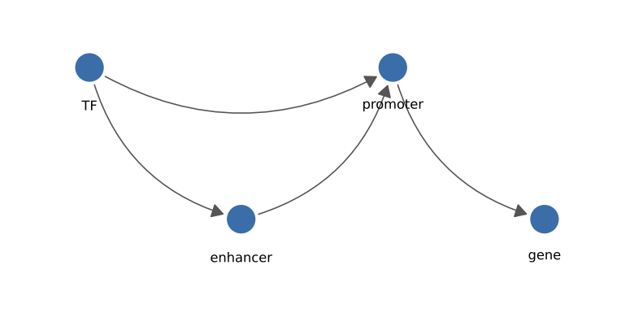
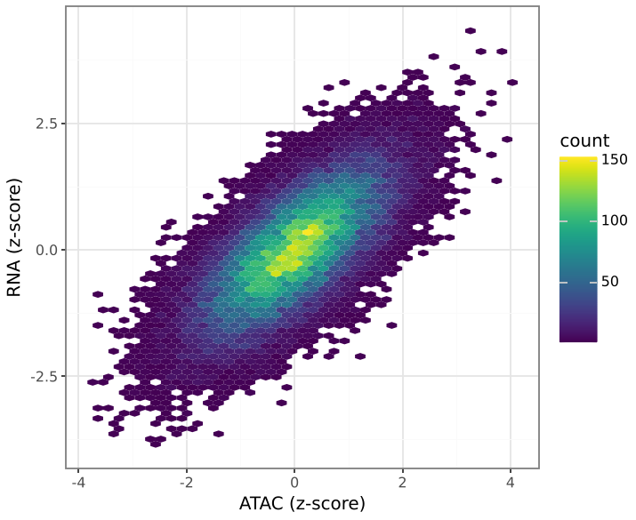

# Curves and hexagons

Two geoms from ggplot2 itself that plotnine does not have.

## geom_curve

Curved segments from (`x`, `y`) to (`xend`, `yend`), for arrows in
annotations and diagrams. Takes plotnine's `arrow()`.

```python
--8<-- "examples/curve.py"
```



| Parameter | Default | |
|---|---|---|
| `curvature` | `0.5` | Bow as a fraction of segment length; positive to the right of the direction of travel, negative to the left, `0` straight |
| `angle` | `90` | Where the bend peaks: below 90 towards the start, above towards the end |
| `arrow` | `None` | `arrow(length=, angle=, ends=, type=)` |
| `shrink` | `0` | Points to stop short of the ends, so arrow heads clear markers (not in ggplot2) |

The curve is computed on screen, so its shape does not depend on the axis
scales. It is a single quadratic Bezier; ggplot2 uses a smoother spline,
so the shapes are similar but not identical, and the sign convention of
`curvature` has not been checked against ggplot2.

## geom_hex

Hexagonal binning: counts of points per hexagon, for scatter plots with
too many points to see.

```python
--8<-- "examples/hex.py"
```



`stat_bin_hex` takes `bins` (hexagons across each axis, default 30) or
`binwidth=(x, y)`, the horizontal distance between neighbouring centres
and the vertical distance between centres in one column. All panels of a
faceted plot share one grid. Computed variables: `count` (the default
fill), `density`, `width`, `height`; map `weight` to sum weights instead
of counting. With `stat="identity"`, give the bin size as
`aes(width=..., height=...)` or `width=, height=`.
