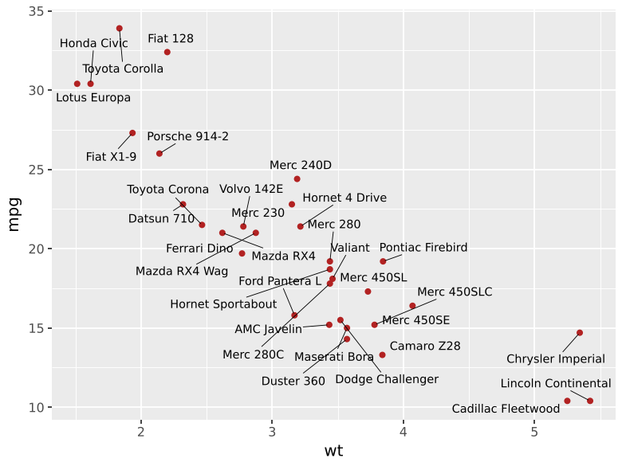
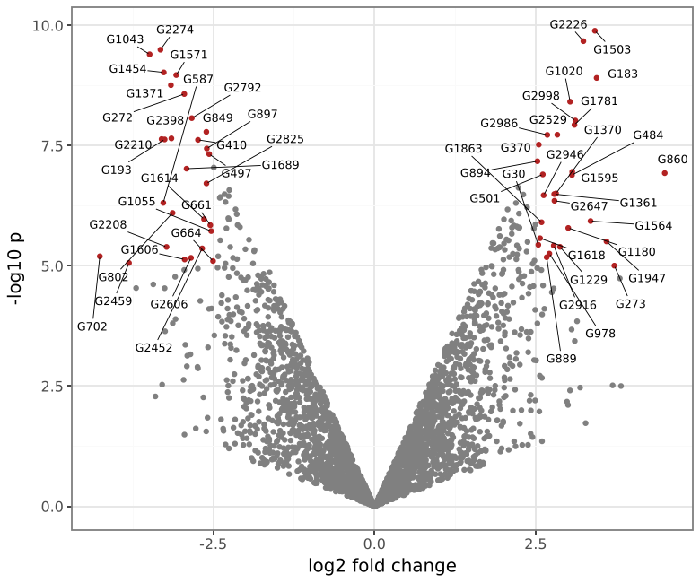

# plotnine-extensions

ggplot2's strength is its extension ecosystem. This package brings the
most-used pieces of it to [plotnine](https://plotnine.org). Everything is
an ordinary plotnine layer: import it and add it to a plot with `+`.

| | ggplot2 counterpart | |
|---|---|---|
| [`geom_text_repel`, `geom_label_repel`](repel.md) | ggrepel | Labels that move off each other and off the data, with leader lines |
| [`rasterise`](rasterise.md) | ggrastr | One layer as a bitmap at its own dpi inside PDF/SVG output |
| [`stat_compare_means`, `geom_bracket`](signif.md) | ggpubr, ggsignif | Statistical tests between groups, drawn as brackets with stars or p-values |
| [`stat_halfeye`, `geom_raincloud`](distributions.md) | ggdist | Densities with medians and intervals; raincloud plots |
| [`geom_logo`](logo.md) | ggseqlogo | Sequence logos, including signed contribution scores |
| [`geom_curve`, `geom_hex`](geoms.md) | ggplot2 | Curved arrows; hexagonal binning |
| [`theme_pubr`, `theme_cowplot`, ...](themes.md) | ggpubr, cowplot | Publication themes and helpers such as `rremove`, `rotate_x_text`, `background_grid` |

## Install

```bash
pip install git+https://github.com/vmindel/plotnine_extensions
```

It needs plotnine 0.15 or later and is tested against 0.15.8 and
plotnine's development branch.

## Quick start

```python
--8<-- "examples/quickstart.py"
```



A genomics-flavoured example uses both features at once: 3,000 points
rasterised, so the PDF stays small, and only the hits labelled.

```python
--8<-- "examples/volcano.py"
```


