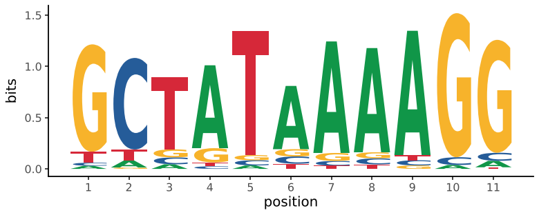
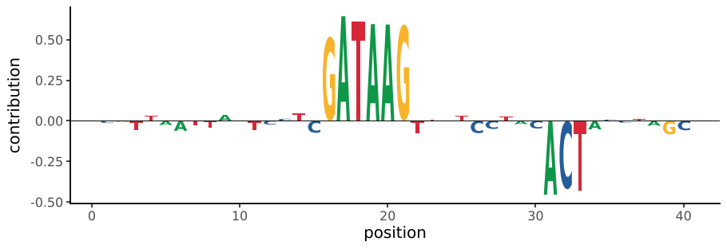
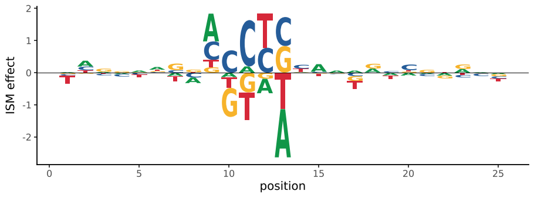

# Sequence logos

`geom_logo` draws sequence logos: one stack of letters per position,
each letter stretched to its height. Negative heights stack below zero,
so contribution scores and in silico mutagenesis (ISM) effects plot the
way they appear in sequence-model papers. Because it's an ordinary
layer, logos facet (one row per region or model), stack with other plots,
and save as vector graphics.

`logo_data` builds the long table the geom takes (`position`, `letter`,
`height`) from aligned sequences or from a matrix.

## From aligned sequences

```python
--8<-- "examples/logo_bits.py"
```



`method="bits"` (the default for sequences) gives each letter its share
of the position's information content, `log2(s) - H` for an alphabet of
`s` letters. With few sequences, information content is overestimated;
`correction=True` subtracts the approximate small-sample correction
`(s - 1) / (2 ln 2 n)` of Schneider et al. (1986). `method="probability"`
and `method="counts"` give frequencies or raw counts. Gaps (`-`) and `N`
are ignored.

## Contribution scores

Models such as BPNet-style networks give hypothetical scores for all
four bases at every position. Show them for the observed sequence by
passing it as `sequence`: other bases are set to zero.

```python
--8<-- "examples/logo_contrib.py"
```



## In silico mutagenesis and other signed matrices

With `method="none"` and no `sequence`, every value is drawn; positive
ones stack up, negative ones down, the largest magnitude farthest from
zero.

```python
--8<-- "examples/logo_ism.py"
```



## Colours

Letters are coloured by `palette`: `"auto"` (default) picks DNA, RNA or
protein from the letters present; `"protein"` colours amino acids by
side-chain chemistry; a `{letter: colour}` dict sets your own. Mapping
`fill` overrides the palette, e.g. `aes(fill="letter")` with
`scale_fill_manual` for a legend.

| `logo_data` input | `alphabet` |
|---|---|
| list of aligned sequences | inferred (DNA, RNA or protein) |
| DataFrame, columns = letters | the columns |
| numpy array, positions x letters | required, e.g. `"ACGT"` |

Glyphs are drawn in matplotlib's default sans-serif font, bold; change it
with `family=` and `fontweight=`. Letters are stretched to fill their
box, so narrow letters such as I become blocks.
