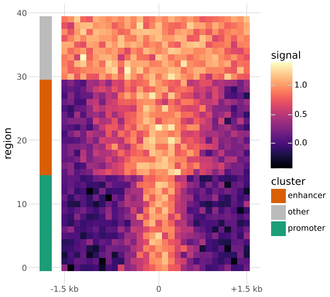
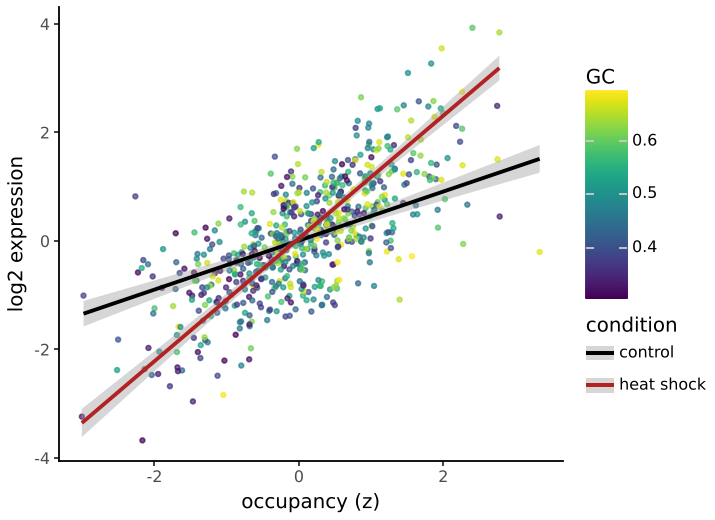

# Several scales per aesthetic

plotnine, like ggplot2, has one scale per aesthetic: every layer that
maps `fill` shares one fill scale and one legend. `new_scale_fill()`,
after R's ggnewscale, closes that scale. Layers added before it keep it;
layers added after it get a new, independent fill scale with its own
legend.

## A heatmap with an annotation bar

```python
--8<-- "examples/newscale_heatmap.py"
```



## Continuous points, discrete fits

```python
--8<-- "examples/newscale_color.py"
```



`new_scale_color()` (or `new_scale_colour()`) does the same for colour,
and `new_scale("size")`, `new_scale("shape")`, ... for the other
non-position aesthetics. `new_scale("color", "fill")` splits both at once.

## Order is everything

Everything about the aesthetic that is in the plot when `new_scale` is
added belongs to the old scale; everything added afterwards belongs to
the new one. That covers:

- layers,
- scales (`scale_fill_cmap(...)` above `new_scale_fill()` styles the
  heatmap, the one below it the annotation bar),
- `labs(fill=...)`,
- `guides(fill=...)`.

So put each scale, label and guide next to the layers it is for. A scale
for the new layers added before `new_scale` styles the old ones instead,
with no warning.

## Things to know

- **Global mappings.** `ggplot(df, aes(color="g"))` is inherited by
  every layer, on both sides of `new_scale_color()`: earlier layers map
  `g` on the old scale and later layers on the new one, unless they map
  colour themselves. Map the aesthetic in each layer instead.
- **Legends merge** when two have the same title, labels and guide type,
  as for any two scales. Give the scales different names.
- **Constants are untouched.** `geom_point(color="red")` before
  `new_scale_color()` stays red and is in neither legend.
- **Stat defaults follow the layer.** `geom_bin_2d()` maps fill to
  `after_stat("count")` by default; before `new_scale_fill()` that count
  goes on the old scale.
- **`guides()` after `new_scale`** only reaches the new scale. To set the
  old scale's guide, pass it to its scale (`guide=...`) or call
  `guides(...)` before `new_scale`.
- **`after_scale()`** in an earlier layer sees the renamed column. The
  aesthetic of earlier layers is renamed internally (`fill` becomes
  `fill_new1`, then `fill_new2` for the next `new_scale_fill()`), as in
  ggnewscale, and named back before the geom draws.
- `x` and `y` cannot be split; they have one scale per panel.

How it works: `new_scale` renames the aesthetic in every earlier layer,
scale, label and guide. The renamed column gets its own scale, is
trained and mapped by it, and is renamed back after mapping, so the geom
draws as usual. Stats and position adjustments also see the usual names
(`position_jitterdodge` still dodges by fill).
