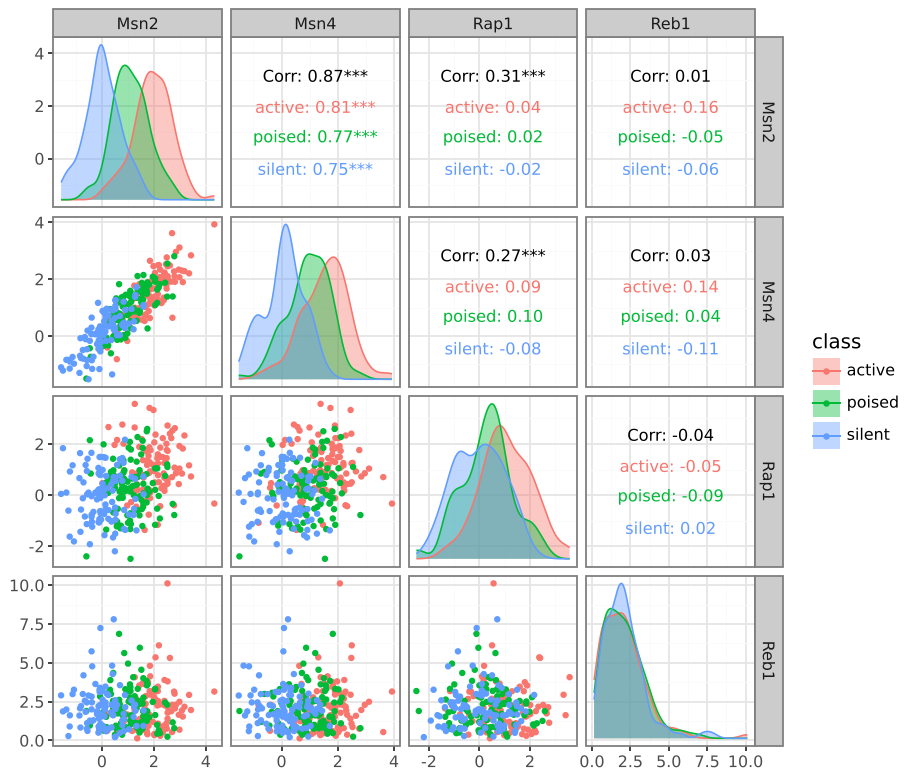
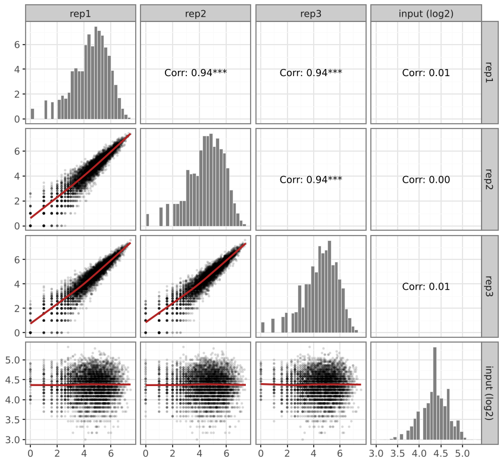

# Scatterplot matrices

`ggpairs` pairs the columns of a data frame, after R's GGally::ggpairs:
scatter plots below the diagonal, each variable's distribution on it,
correlation coefficients above it. It returns one ordinary `ggplot`
(faceted with `facet_grid("yvar ~ xvar", scales="free")`), so themes,
scales and further layers add on with `+`, and `rasterise` works on it.

## Groups

```python
--8<-- "examples/pairs_basic.py"
```



`color=` names a grouping column. It colours points and lines, fills
the densities, and splits each coefficient by group under the overall
one. A numeric column is treated as categorical. Recolour both points
and fills with one scale:
`scale_color_manual(values=[...], aesthetics=["color", "fill"])`.

Each column of panels shares its variable's x axis and each row its
variable's y axis. The diagonal densities (and histograms) are rescaled
into the row's range, so every y axis reads in the variable's units,
not in density. Densities are per group, each integrating to one, with
R's default bandwidth (`bw.nrd0`).

The stars follow GGally: `***` p < 0.001, `**` < 0.01, `*` < 0.05,
`.` < 0.1. A matrix of n variables with k groups draws
n(n − 1) / 2 × (k + 1) tests, so pass `adjust="holm"` or `"bh"` if the
stars are going to carry an argument; GGally does not adjust.

## Your own layers, many points

```python
--8<-- "examples/pairs_custom.py"
```



`lower` and `upper` take `"points"`, `"smooth"` (points and a linear fit),
`"density2d"`, `"cor"` or `"blank"`, or any geom, stat or list of them.
Given layers draw only in their triangle and inherit the `x`, `y` and
`color` mappings. `diag` takes `"density"`, `"hist"` or `"blank"`.

With thousands of points, `rasterise(p, layers=["point"])` keeps the
axes and text vector and the PDF small (here 5,000 points in 6 panels).

## Adding layers afterwards

The plot's data is the long form of the pairs: one row per observation
and panel, with `x`, `y`, `xvar`, `yvar`, `part` (`"lower"` or
`"upper"`), and every column of the input that is not paired. A layer
added with `+` draws in every panel that has data; restrict it with a
data function:

```python
from plotnine import aes
from plotnine_extensions import geom_text_repel, ggpairs

df["promoter"] = [f"p{i}" for i in range(len(df))]
top = set(df.nlargest(5, "Msn2")["promoter"])
p = ggpairs(df, color="class") + geom_text_repel(
    aes(label="promoter"), color="black", size=7,
    data=lambda d: d[(d.part == "lower") & d.promoter.isin(top)],
)
```

Panels that show coefficients or nothing add no rows, so a layer
added afterwards cannot draw there; pass it as `upper=[...]` instead.

## Differences from GGally

- Only numeric columns are paired. Categorical variables go in `color`;
  GGally's box plots and bar charts for mixed pairs are not drawn,
  because one faceted plot cannot hold discrete and continuous axes in
  the same column.
- The figure is a single ggplot, not a `ggmatrix`: no `p[2, 1]`
  indexing. Subset the data or change `lower` / `upper` instead.
- `labels` replaces `columnLabels`; `cor_size` is in points.
- Tick labels of neighbouring panels can touch at small sizes; enlarge
  the figure or add `theme(panel_spacing=...)`.
