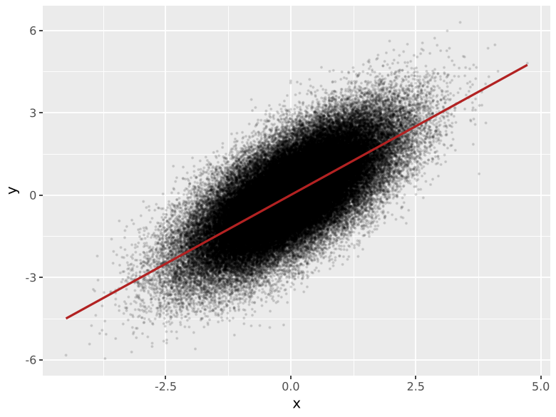

# Rasterising layers

Vector figures with tens of thousands of points are slow to open and
too large to send or submit. `rasterise` renders a single layer as a
bitmap and embeds it in otherwise vector output. Axes, text, legends and
the layers you leave alone stay vector, so they remain sharp and
editable in Illustrator or Inkscape.

```python
--8<-- "examples/rasterise_basic.py"
```



--8<-- "generated/raster_sizes.md"

## What it accepts

```python
rasterise(geom_point(), dpi=300)                 # a geom
rasterise(stat_bin_2d(), dpi=300)                # a stat
rasterise([geom_point(), geom_rug()], dpi=300)   # several at once
rasterise(p, dpi=300)                            # every layer of a plot
rasterise(p, dpi=300, layers=["point", "bin_2d"])  # some layers
```

A geom, stat or list is changed in place and returned, ready to add
with `+`. A whole `ggplot` is copied first.

## Output formats

| Output | Effect |
|---|---|
| PDF, SVG, EPS/PS | The layer is one embedded image per panel at `dpi` |
| PNG, JPEG, screen | No change: the output is a bitmap already |

The dpi of `rasterise` is independent of the `dpi` passed to
`ggplot.save`. `dpi=None` defers to matplotlib, and the layer stays
vector unless something else rasterises it.

## Choosing a dpi

300 is the usual minimum for print. Points far smaller than a pixel at
the chosen dpi turn into a blur; if a layer has very small markers,
raise the dpi before increasing the marker size. Journals that check
figure resolution read the embedded image, which is exactly the dpi you
set.

## Compared with `raster=True`

plotnine layers already accept `raster=True`, which sets matplotlib's
`rasterized` flag:

| | `raster=True` | `rasterise()` |
|---|---|---|
| Resolution | The `dpi` passed to `save` | Set per layer |
| Geoms | Those that forward the flag | Any |
| Several layers | Each at the save dpi | Each at its own dpi |

At equal dpi the images are pixel-identical: `rasterise` draws with the
same Agg renderer that matplotlib's rasterisation uses.
