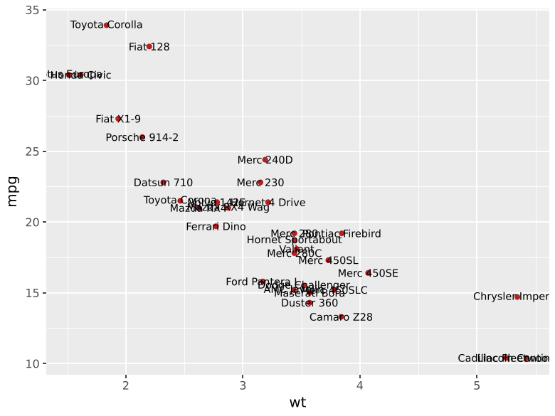
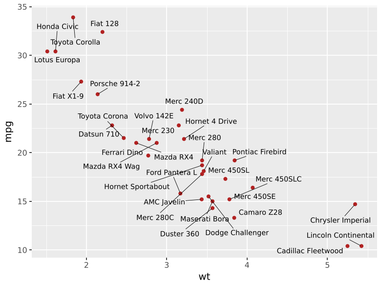
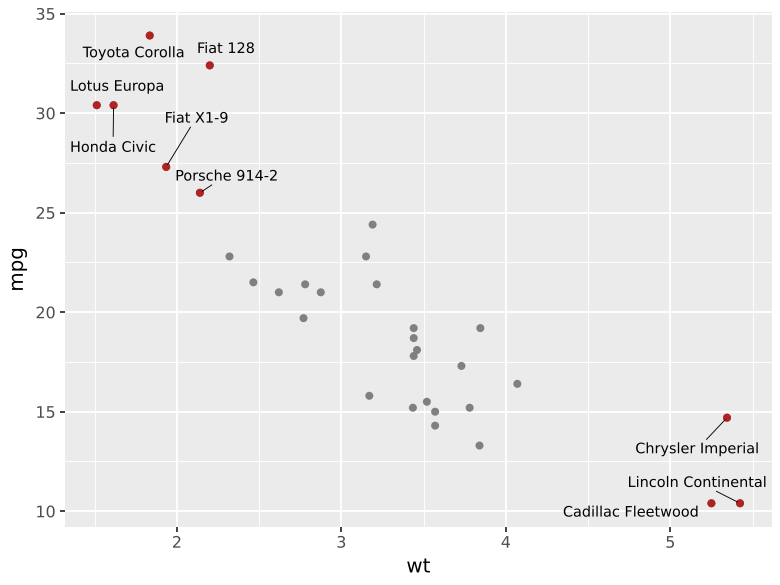
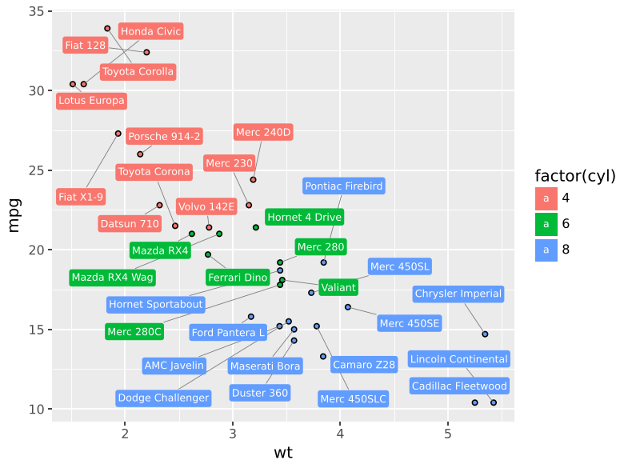
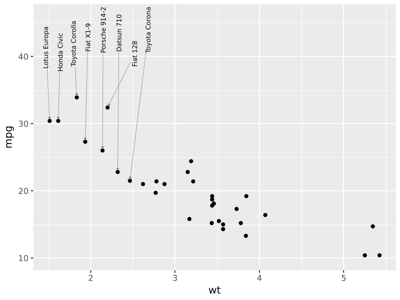
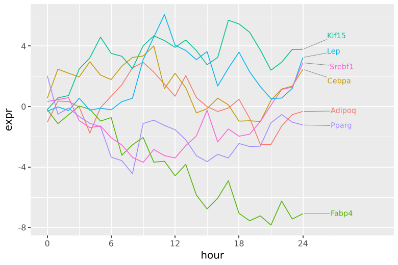

# Repelling labels

`geom_text_repel` and `geom_label_repel` behave like `geom_text` and
`geom_label`, except that labels move until they no longer overlap each
other or the data points. A segment connects a label to its point when
the label had to move.

=== "geom_text"

    

=== "geom_text_repel"

    

```python
--8<-- "examples/quickstart.py"
```

## How placement works

Labels are placed while matplotlib renders the figure, with the renderer
writing the file. Text sizes and positions are measured on the final
figure: after plotnine has laid out the panels, and at the dpi of the
output. Saving the same plot at a different size or format reruns the
placement, so the layout always fits the figure you get.

plotnine's built-in alternative, `geom_text(adjust_text=...)`, adjusts
once while the layer is being drawn. Its documentation warns that it
works poorly as the first or only layer.

Within each panel, every label is a box and every data point an
obstacle. Boxes are pushed out of whatever they overlap and pulled back
to their point by a spring. A final pass swaps labels whose segments
cross. Facets are placed independently.

## Labelling a subset

Give the rows you do not want labelled an empty string (or a missing
value). Do not drop them: their points still keep labels off themselves.

```python
--8<-- "examples/subset.py"
```



## Label boxes

`geom_label_repel` takes `fill` as an aesthetic and the box options of
`geom_label` (`boxstyle`, `boxcolor`, `label_padding`, `label_r`,
`label_size`).

```python
--8<-- "examples/label_repel.py"
```



Segments take the label's colour unless `segment_color` is set; with
white text, set it.

## Steering where labels go

`nudge_x` / `nudge_y` set where a label starts, in data units. Unlike in
`geom_text`, the segment still points at the original data point.

`direction="x"` or `"y"` lets labels move along one axis only.
`xlim` / `ylim` confine labels to a data range (`None` for the panel
edge). Combined, they line labels up in a margin.

```python
--8<-- "examples/segments.py"
```



Labelling the ends of lines follows the same pattern: start the labels
to the right of the data, allow only vertical movement, and keep the
labels right of the last time point.

```python
--8<-- "examples/line_ends.py"
```



`xlim` and `ylim` are in data units and go through the scale's
transformation, so they work as expected with log and reversed scales.

## Segments

| Parameter | Default | |
|---|---|---|
| `min_segment_length` | `6` | Shorter segments (points) are not drawn |
| `segment_color` | label colour | |
| `segment_size` | `0.5` | Line width, points |
| `segment_alpha` | label alpha | |
| `segment_linetype` | `"solid"` | |
| `arrow` | `None` | A dict for matplotlib's `FancyArrowPatch`, e.g. `{"arrowstyle": "-|>", "mutation_scale": 6}`; `{}` for the default arrow |

## Spacing

| Parameter | Default | |
|---|---|---|
| `box_padding` | `3` | Space (points) kept free around each label |
| `point_padding` | `0` | Extra space (points) around each data point |
| `point_size` | `1.5` | Size of the drawn points, in `geom_point` units |

Set `point_size` to the size of the points you actually draw, so labels
clear the markers and not only their centres.

## Too many labels

When labels cannot all be placed, `max_overlaps` (default `10`) drops
those that, after placement, still overlap more than that many labels
or points. Earlier rows win, so sort the data by priority first, as in
the volcano example on the [home page](index.md). A warning reports how
many labels were dropped. `max_overlaps=np.inf` keeps everything.

Placement stops after `max_time` seconds (default `1`) or `max_iter`
iterations per panel. Dense layouts with more than about 60 labels in
one crowded region may need a longer `max_time`, or fewer labels.

`force` and `force_pull` scale the push between overlapping items and
the pull back to the point.

## Reproducibility

`seed=1` by default, so a figure renders identically every time.
`seed=None` gives a different layout on each draw.

## Units

Distances are in points (1/72 inch). ggrepel uses "lines"; one line at
11 pt text is roughly 13 points.
