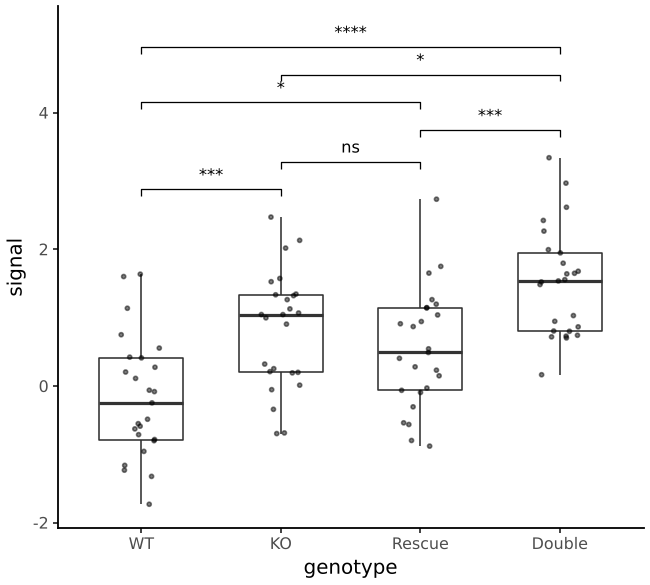
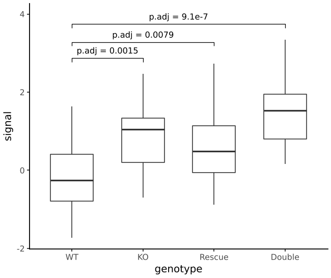
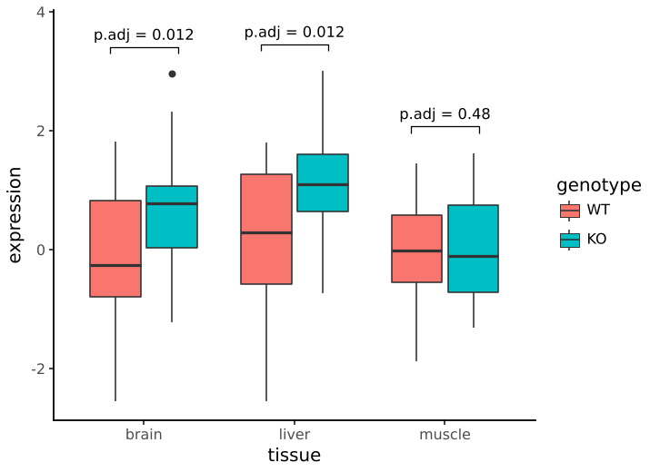
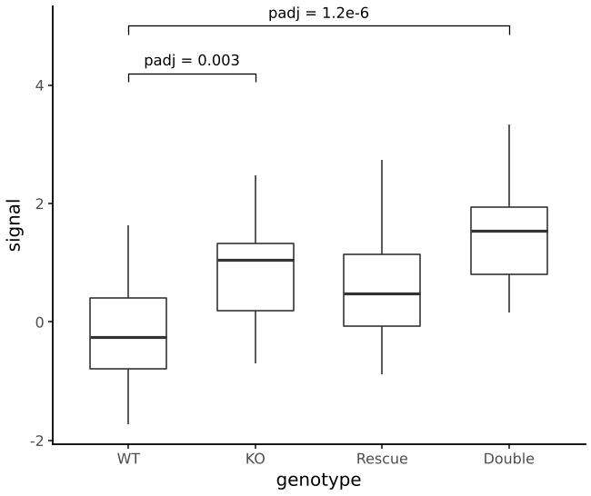

# Significance brackets

`stat_compare_means` tests differences between groups and draws brackets
with stars or p-values, in the spirit of R's ggpubr and ggsignif. The
tests run on the raw observations of each group, separately in each
panel.

```python
--8<-- "examples/signif_pairs.py"
```



## Choosing comparisons

| | |
|---|---|
| default | every pair of x categories |
| `comparisons=[("WT", "KO"), ("WT", "Double")]` | the listed pairs, by name |
| `ref_group="WT"` | every other group against one |
| `within="fill"` | levels of an aesthetic within each x category, for dodged plots |

```python
--8<-- "examples/signif_ref.py"
```



For dodged plots, map the same aesthetic in `stat_compare_means` and
name it in `within`. Brackets sit on the dodged positions of
`geom_boxplot`'s default width; set `dodge_width` if you dodge by a
different amount.

```python
--8<-- "examples/signif_dodge.py"
```



## Tests and corrections

| `method` | test | with `paired=True` |
|---|---|---|
| `"t-test"` (default) | Welch's t-test (R's `t.test` default) | paired t-test |
| `"student"` | Student's t-test (equal variances) | paired t-test |
| `"mann-whitney"` | Mann-Whitney U (R's `wilcox.test`, two samples) | Wilcoxon signed-rank |

Paired tests pair observations by their order within each group.

`p_adjust` corrects across the comparisons in a panel: `"holm"`
(default), `"bh"` (false discovery rate), `"bonferroni"` or `None`.
ggpubr's brackets are uncorrected by default. Here correction is on,
because a figure with six brackets is six tests. Labels then read
`p.adj`.

`label_type="stars"` (default) shows `ns`, `*` (p ≤ 0.05), `**` (≤ 0.01),
`***` (≤ 0.001) or `****` (≤ 0.0001); `label_type="p"` shows the value.
`hide_ns=True` leaves out non-significant brackets.

Brackets stack automatically: each goes just above the data it spans and
above any bracket it overlaps, narrowest first. `step` and `tip_length`
set the spacing as fractions of the data range.

## Your own p-values

`geom_bracket` draws brackets from a table: p-values from a mixed model,
DESeq2, limma or anything else. `xmin` and `xmax` can be category names.

```python
--8<-- "examples/signif_manual.py"
```



`p_adjust(p, method)` and `format_p(p, label_type)` are available on
their own for the same corrections and labels.
