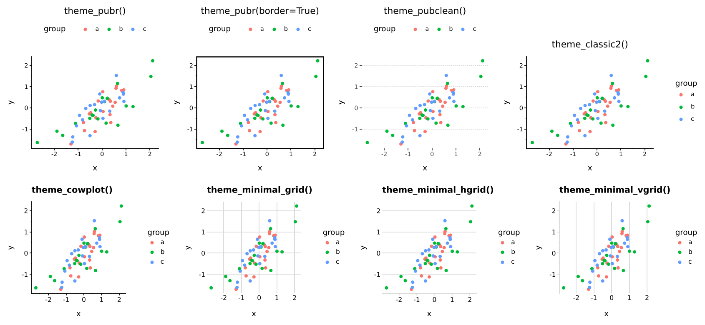
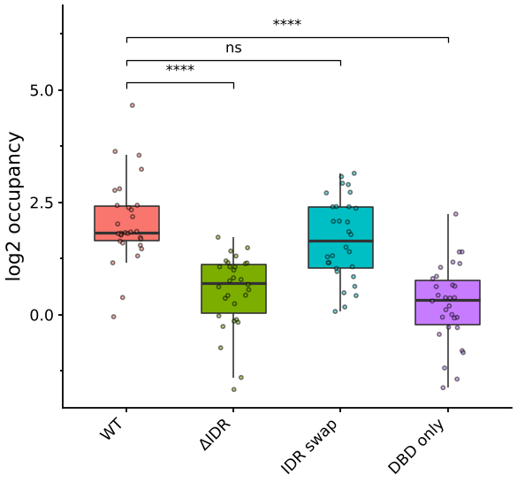
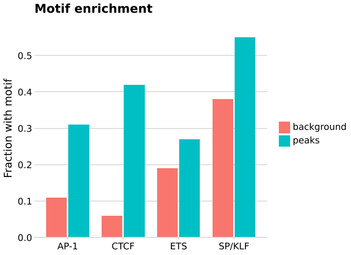

# Themes

Publication themes from ggpubr and cowplot, plus their helper functions
for removing, rotating and restyling single elements. The themes are
complete plotnine themes, so they replace the current theme; the helpers
return partial themes, so add them after the theme they modify.



## ggpubr

```python
--8<-- "examples/themes_pubr.py"
```



| | |
|---|---|
| `theme_pubr()` | Black axis lines, no grid, legend on top, light grey strips with a black frame |
| `theme_pubr(border=True)` | A box around the panel instead of the two axis lines |
| `theme_pubr(margin=False)` | Almost no plot margin, for panels assembled into a figure |
| `theme_pubr(legend="none")` | Also `"bottom"`, `"left"`, `"right"`, or `(x, y)` inside the panel |
| `theme_pubr(x_text_angle=45)` | Rotated x tick labels, right-aligned under their ticks |
| `theme_pubclean()` | White panel, dotted grid on y only; `flip=True` puts it on x |
| `theme_classic2()` | plotnine's `theme_classic` with axes, ticks and tick labels in black |

`base_size` defaults to 12 as in ggpubr; plotnine's own themes use 11.

### Helpers

| | |
|---|---|
| `rremove("x.text", "legend", ...)` | Remove elements by ggpubr's names: `grid`, `x.grid`, `y.grid`, `axis`, `x.axis`, `y.axis`, `xlab`, `ylab`, `xylab`, `legend`, `legend.title`, `ticks`, `x.ticks`, `y.ticks`, `axis.text`, `x.text`, `y.text` |
| `rotate_x_text(angle=90)`, `rotate_y_text()` | Rotate tick labels |
| `grids(axis="y")` | Dashed major grid lines on a theme that has none |
| `border()` | Black box around each panel |
| `bgcolor("#FFF8E7")` | Panel fill |
| `font("title", size=16, face="bold")` | Font of one element: `title`, `subtitle`, `caption`, `xlab`, `ylab`, `xylab`, `legend.title`, `legend.text`, `x.text`, `y.text`, `xy.text`, `strip.text` |
| `clean_theme()` | No axis lines, ticks, tick labels or titles, for marginal plots |

ggpubr's names use dots; `rremove("x_text")` works as well. `rremove`
takes several names in one call, where ggpubr needs one call per name.

## cowplot

```python
--8<-- "examples/themes_cowplot.py"
```



| | |
|---|---|
| `theme_cowplot()`, `theme_half_open()` | Open axes, no grid, bold left-aligned title. The two names are the same theme |
| `theme_minimal_grid()` | Light major grid, no axis lines or ticks |
| `theme_minimal_hgrid()` | Horizontal grid only, x axis line and ticks in the grid colour; for vertical bars |
| `theme_minimal_vgrid()` | Vertical grid only; for horizontal bars |
| `theme_map()` | No axes, ticks or tick labels; for maps, images and UMAP/t-SNE embeddings |
| `theme_nothing()` | Nothing but the data: no axes, legend or margin |
| `background_grid(major="y", minor="none")` | Set grid lines on any theme; directions not named are removed |
| `panel_border()` | Light grey box around each panel; `remove=True` takes it away |

`font_size` defaults to 14. Tick labels, legend text and strip text are
`rel_small` (12/14) of it, the title `rel_large` (16/14) and the caption
`rel_tiny` (11/14).

## Differences from R

- **Line widths are points.** plotnine's themes draw ggplot2's default
  0.5 mm line as 1 pt, so cowplot's `line_size = 0.5` is `line_size=1`
  here, and every `size` argument of the helpers is about twice its R
  value.
- **Colours are matplotlib colours.** R names such as `"grey85"` do not
  exist in matplotlib; defaults use the hex values (`"grey85"` is
  `"#D9D9D9"`, `"grey92"` is `"#EBEBEB"`).
- **Argument names swap dots for underscores**: `x.text.angle` becomes
  `x_text_angle`, `size.major` becomes `size_major`.
- **Plot background stays white** in the cowplot themes. cowplot makes it
  transparent, which saves PNGs with a transparent background.
- **Titles in the ggpubr themes are centred**, as in every plotnine
  theme; ggplot2 left-aligns them. Add `theme(plot_title=element_text(ha="left"))`
  to match R. The cowplot themes left-align, as cowplot does.
- The themes reproduce the look of the R originals element by element,
  not pixel for pixel: text measurement and default spacing differ
  between grid and matplotlib.
- Not included: ggpubr's `labs_pubr`, cowplot's `theme_minimal`
  (use plotnine's) and the cowplot plot-assembly functions
  (`plot_grid`, `ggdraw`); for assembly use plotnine's `|` and `/`
  composition.
